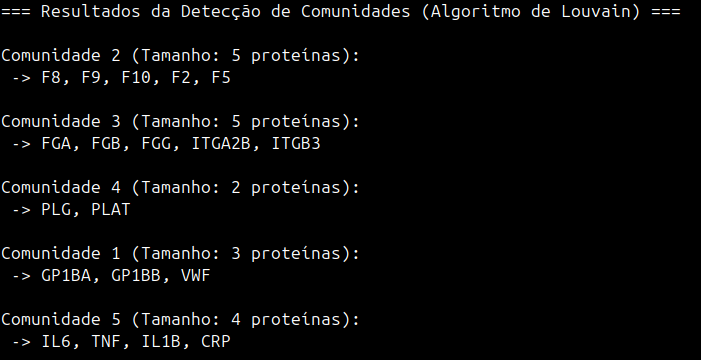

# Detecção de Comunidades em Redes PPI usando Algoritmo de Louvain

## Objetivo
Este projeto tem como objetivo modelar uma Rede de Interação Proteína-Proteína (PPI) focada nos sistemas de hemostasia, cascata de coagulação e resposta inflamatória aguda. A partir dessa modelagem, o script identifica subgrupos funcionais (complexos proteicos ou vias biológicas integradas) utilizando o método de agrupamento por maximização de modularidade.

## O que o código faz
1. **Construção da Rede:** Utiliza a biblioteca `networkx` para estruturar um grafo não direcionado. Os nós representam proteínas fundamentais (fatores de coagulação, receptores plaquetários e citocinas) e as arestas representam suas interações biológicas reportadas.
2. **Análise de Comunidades:** Aplica o **Algoritmo de Louvain** através do método `best_partition`, que agrupa os nós iterativamente para encontrar a divisão que otimiza a densidade de conexões internas em comparação com as conexões entre grupos diferentes.
3. **Mapeamento de Saída:** Converte o dicionário de partições nativo do algoritmo em uma estrutura reversa organizada por ID de comunidade, facilitando a interpretação biológica dos resultados diretamente no console.

## Resultados



## Requisitos
Para rodar este script, certifique-se de ter o Python 3.x instalado juntamente com as seguintes dependências:
- `networkx`
- `python-louvain`

Você pode instalar ambos os pacotes executando o comando abaixo no seu terminal:
```bash
pip install networkx python-louvain
```
